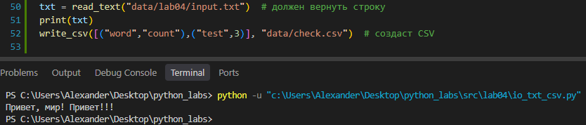
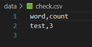
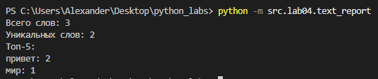
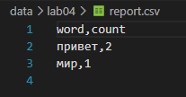
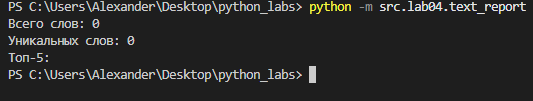
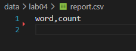
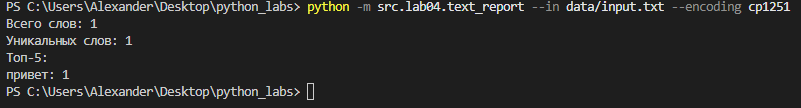
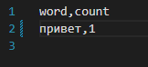

# ЛР4 — Файлы: TXT/CSV и отчёты по текстовой статистике

## Задание A
### read_text
```python
def read_text(path: str | Path, encoding: str = "utf-8") -> str:
    '''
    Открывает файл на чтение и возвращает содержимое как одну строку.
    Кодировка по умолчанию UTF-8, чтобы выбрать другую, её нужно передать в параметр функции (пример: encoding = "cp1251").
    Если файл не найден - FileNotFoundError, пусть "падает".
    Если неподходящая кодировка - UnicodeDecodeError, пусть "падает".
    '''
    p = Path(path)
    return p.read_text(encoding=encoding)
```

### ensure_parent_dir
```python
def ensure_parent_dir(path: str | Path) -> None:
    '''
    Создаёт родительские директории, если таковые отсутствуют.
    '''
    p = Path(path)
    p.parent.mkdir(parents=True, exist_ok=True)
```


### write_csv
```python
def write_csv(rows: Iterable[Sequence], path: str | Path, 
              header: tuple[str, ...] | None = None) -> None:
    '''
    Создаёт/перезаписывает CSV с разделителем ",".
    Если передан header, то он будет записан первой строкой.
    Проверяется, что все строки в rows одинаковой длины, иначе raise ValueError.
    '''
    p = Path(path)
    rows = list(rows)

    lens = {len(r) for r in rows}
    if header is not None:
        lens.add(len(header))
    if len(lens) > 1:
        raise ValueError("Все строки должны быть одинаковой длины")

    ensure_parent_dir(path)
    with p.open("w", newline="", encoding="utf-8") as f:
        w = csv.writer(f)
        if header is not None:
            w.writerow(header)
        for r in rows:
            w.writerow(r)
```

### Ручной мини-тест для README





## Задание B
```python
import sys
from src.lib.text import normalize, tokenize, count_freq, top_n
from src.lab04.io_txt_csv import read_text, write_csv

def main():
    try:
        raw_text = read_text("data/lab04/input.txt", encoding="utf-8")
    except FileNotFoundError:
        print("Файл не найден")
        sys.exit(1)
    
    normal = normalize(raw_text)
    tokens = tokenize(normal)
    unique_tokens = count_freq(tokens)
    top_5 = top_n(unique_tokens, n=5)
    all_rows = sorted(unique_tokens.items(), key= lambda x: (-x[1], x[0]))

    write_csv(all_rows, "data/lab04/report.csv", header= ("word", "count"))
    print(f"Всего слов: {len(tokens)}")
    print(f"Уникальных слов: {len(unique_tokens)}")
    print(f"Топ-5:")
    for n in top_5:
        print(f"{n[0]}: {n[1]}")

if __name__ == "__main__":
    main()
```

1) Через функцию read_text пытаемся прочесть входной файл input.txt, путь к которому "захардкожен" (data/lab04/input.txt).
2) Если файл не найден, скрипт завершается с кодом 1 и выводом ошибки в терминал.
3) Входной текст нормализуется, токенизируется, частоты токенов и топ-5 самых частых считаются.
4) Сохраняется отчёт по пути (data/lab04/report.csv) с колонками **`word, count`**, отсортированными: count ↓, слово ↑ (при равенстве).
5) В консоль печатает краткое резюме:  
   - `Всего слов: <N>`  
   - `Уникальных слов: <K>`  
   - `Топ-5:`

### Тест-кейс для непустого `input.txt`




### Тест-кейс для пустого `input.txt`




### Тест-кейс для `input.txt` с текстом `Привет` в кодировке cp1251




## Нюансы:
### io_txt_csv.py 
Если файл очень большой, он по ТЗ будет читаться целиком, но в реальных ситуациях стоит читать построчно.

Пустой файл → возвращается пустая строка.

`write_csv` с пустым `rows` и `header=None` → создаётся пустой файл (0 строк). Если `header=("a","b")` → файл содержит только заголовок.

### text_report.py
Если входного файла не существует → `print("Файл не найден")`, `sys.exit(1)`.

Входной файл пустой → `report.csv` будет содержать только заголовок.

Другая кодировка → указать параметр `--encoding ...` при запуске из терминала


