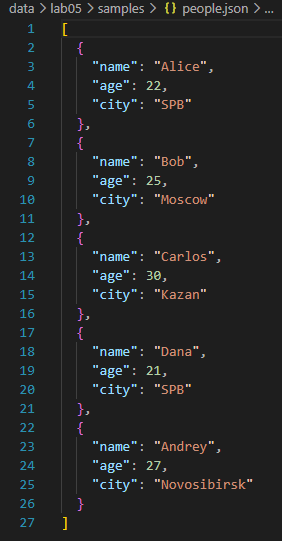
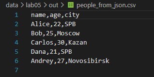
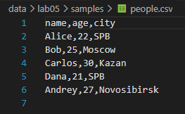
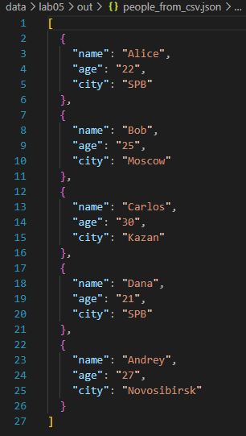
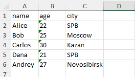
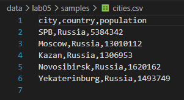
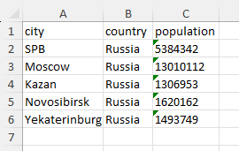

# ЛР5 — JSON и конвертации (JSON↔CSV, CSV→XLSX): Техническое задание

## Задание A — JSON ↔ CSV

### `json_to_csv`
```python
from pathlib import Path
import json
import csv


def json_to_csv(json_path: str, csv_path: str) -> None:
    '''
    Преобразует JSON-файл в CSV.
    Поддерживает список словарей [{...}, {...}], заполняет отсутствующие поля пустыми строками.
    Кодировка UTF-8. Порядок колонок — как в первом объекте.
    '''
    json_file = Path(json_path)
    csv_file = Path(csv_path)

    if not json_file.suffix.lower() == ".json":
        raise ValueError("Входной файл не .json")
    if not csv_file.suffix.lower() == ".csv":
        raise ValueError("Выходной файл не .csv")

    if not json_file.exists():
        raise FileNotFoundError("Не найден входной JSON")

    with open(json_file, "r", encoding="utf-8") as f:
        try:
            data = json.load(f)
        except json.JSONDecodeError:
            raise ValueError("Некорректный или пустой JSON")

    if (not isinstance(data, list) or not data or not all(isinstance(item, dict) for item in data)):
        raise ValueError("JSON должен содержать непустой список словарей")

    csv_file.parent.mkdir(parents=True, exist_ok=True)

    keys_dict = {}
    for item in data:
        for k in item.keys():
            keys_dict[k] = None
    fieldnames = list(keys_dict.keys())  

    with open(csv_file, "w", encoding="utf-8", newline="") as f:
        writer = csv.DictWriter(f, fieldnames=fieldnames, restval="")
        writer.writeheader()
        writer.writerows(data)
```

1) Проверяем, что входной и выходной файлы в форматах .json и .csv соответственно.
2) Проверяем существование входного JSON.
3) Читаем JSON в UTF-8 и проверяем на корректность/пустоту.
4) Проверяем, что JSON является непустым списком словарей.
5) Собираем названия будущих столбцов в том порядке, в каком они во входном JSON.
6) Записываем заголовок и строки в CSV в UTF-8.


Тест-кейс:






### `csv_to_json`
```python
from pathlib import Path
import json
import csv


def csv_to_json(csv_path: str, json_path: str) -> None:
    '''
    Преобразует CSV в JSON (список словарей).
    Заголовок обязателен, значения сохраняются как строки.
    json.dump(..., ensure_ascii=False, indent=2)
    '''
    json_file = Path(json_path)
    csv_file = Path(csv_path)

    if json_file.suffix.lower() != ".json":
        raise ValueError("Выходной файл не .json")
    if csv_file.suffix.lower() != ".csv":
        raise ValueError("Входной файл не .csv")

    if not csv_file.exists():
        raise FileNotFoundError("Не найден входной CSV")

    with open(csv_file, "r", encoding="utf-8", newline="") as f:
        reader = csv.DictReader(f)
        data = list(reader)
        if not reader.fieldnames or not data:
            raise ValueError("CSV-файл пуст или не содержит заголовка")
        

    json_file.parent.mkdir(parents=True, exist_ok=True)

    with open(json_file, "w", encoding="utf-8") as f:
        json.dump(data, f, ensure_ascii=False, indent=2)
```
1) Проверяем, что выходной и входной файлы в форматах .json и .csv соответственно
2) Проверяем существование входного CSV.
3) Читаем CSV в UTF-8, проверяем наличие заголовка и хотя бы одной строки данных.
4) Преобразуем строки данных в словари.
5) Сохраняем список словарей в JSON с indent=2 для красивого вида.

Тест-кейс:





## Задание B — CSV → XLSX
```python
from pathlib import Path
import csv
from openpyxl import Workbook
from openpyxl.utils import get_column_letter


def csv_to_xlsx(csv_path: str, xlsx_path: str) -> None:
    '''
    Конвертирует CSV в XLSX с помощью openpyxl.
    Первая строка CSV - заголовок.
    Лист называется "Sheet1".
    Ширина колонок - автоширина по длине текста, но не менее 8 символов.
    '''
    csv_file = Path(csv_path)
    xlsx_file = Path(xlsx_path)

    if csv_file.suffix.lower() != ".csv":
        raise ValueError(f"Входной файл не .csv, а {csv_file.suffix.lower()}")
    if xlsx_file.suffix.lower() != ".xlsx":
        raise ValueError(f"Выходной файл не .xlsx, a {xlsx_file.suffix.lower()}")

    if not csv_file.exists():
        raise FileNotFoundError("Не найден входной CSV")

    with open(csv_file, "r", encoding="utf-8", newline="") as f:
        reader = csv.reader(f)
        data = list(reader)
        if not data:
            raise ValueError("CSV пуст")

    wb = Workbook()
    ws = wb.active
    ws.title = "Sheet1"
    
    for row in data:
        ws.append(row)
    
    for col in ws.columns:
        max_len = max(len(str(cell.value or "")) for cell in col)
        col_letter = get_column_letter(col[0].column)
        ws.column_dimensions[col_letter].width = max(8, max_len)
    
    xlsx_file.parent.mkdir(parents=True, exist_ok=True)
    wb.save(xlsx_file)
```

1) Проверяем, что входной и выходной файлы в форматах .csv и .xlsx соответственно. Иначе выводим формат в терминал.
2) Проверяем существование входного CSV.
3) Читаем CSV в UTF-8 и проверяем его на полное отсутствие данных.
4) С помощью `openpyxl` создаём книгу Excel с листом `Sheet1`
5) Рассчитываем ширину каждого столбца.
6) Сохраняем книгу Excel.

Тест-кейс 1:





Тест-кейс 2:





### Запуск
Из корня репозитория: `python -m src.lab05.json_csv` или `python -m src.lab05.csv_xlsx`