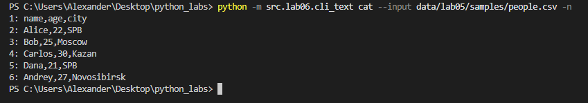
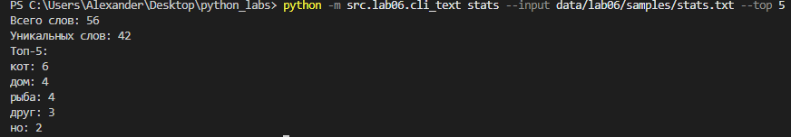
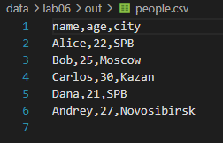
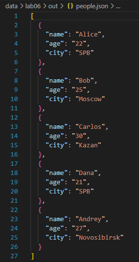
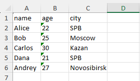
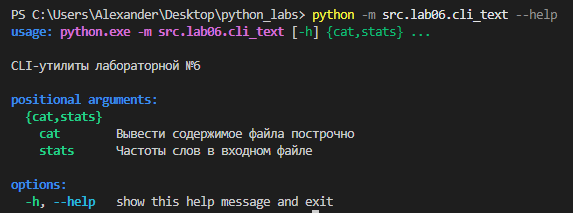
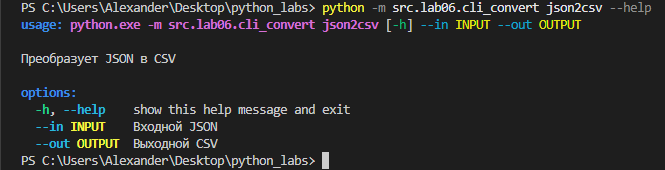

 # ЛР6 — CLI‑утилиты с argparse (cat/grep‑lite + конвертеры): Техническое задание

 ## Задание А (cli_text)
 Модуль с 2 субкомандами. `cat --input <input_path> [-n]` выводит содержимое файла построчно, `-n` также добавляет номера строк в начале (опционально).

 `stats --input <input_path> [--top N]` для общего числа слов, числа уникальных слов и Топ-N самых частых слов (N=5 по умолчанию) с помощью функций из ЛР3.

 Файл читается с помощью read_text из ЛР4.


 ```python
import argparse
import sys
from src.lib.text import normalize, tokenize, count_freq, top_n
from src.lib.io_helpers import read_text

def read_input(path: str) -> str:
    '''
    Читает текстовый файл в UTF-8 и возвращает его содержимое.
    Если файл не найден или не в UTF-8 - выводится сообщение об ошибке через stderr
    и завершает программу с кодом 1.
    '''
    try:
        return read_text(path)
    except FileNotFoundError:
        print(f"Входной файл не найден: {path}", file=sys.stderr)
        sys.exit(1)
    except UnicodeDecodeError:
        print(f"Не удалось прочитать входной файл {path} в UTF-8", file=sys.stderr)
        sys.exit(1)

def sub_cat(args: argparse.Namespace) -> None:
    '''
    Подкоманда cat выводит содержимое файла построчно.
    Если указан флаг -n, то перед каждой строкой указан её номер.
    '''
    text = read_input(args.input)
    lines = text.splitlines()
    for number, line in enumerate(lines, start=1):
        if args.n:
            print(f"{number}: {line}")
        else:
            print(f"{line}")

def sub_stats(args: argparse.Namespace) -> None:
    '''
    Подкоманда stats считает частоты слов в файле,
    возвращает общее число слов, число уникальных слов и топ слов.
    '''
    text = read_input(args.input)

    norm = normalize(text)
    tokens = tokenize(norm)
    freq = count_freq(tokens)

    print(f"Всего слов: {len(tokens)}")
    print(f"Уникальных слов: {len(freq)}")
    print(f"Топ-{args.top}:")
    for word, count in top_n(freq, n=args.top):
        print(f"{word}: {count}")

def main() -> None:
    parser = argparse.ArgumentParser(description="CLI‑утилиты лабораторной №6")
    subparsers = parser.add_subparsers(dest= "command")

    cat_parser = subparsers.add_parser("cat", help="Вывести содержимое файла построчно")
    cat_parser.add_argument("--input", required=True, help="Путь к входному файлу")
    cat_parser.add_argument("-n", action="store_true", help="Нумеровать строки")

    stats_parser = subparsers.add_parser("stats", help="Частоты слов в входном файле")
    stats_parser.add_argument("--input", required=True, help="Путь к входному файлу")
    stats_parser.add_argument("--top", type=int, default=5, help="Количество топовых слов (5 по умолчанию)")

    args = parser.parse_args()

    if args.command == "cat":
        sub_cat(args)
    elif args.command == "stats":
        sub_stats(args)

if __name__=="__main__":
    main()
 ```


 ### Тесты:
 #### cat for people.csv
 


 #### stats for stats.txt
 


 ## Задание B (cli_convert)
Модуль с 3 субкомандами: `json2csv`, `csv2json`, `csv2xlsx`.

По 2 обязательных параметра: `--in` для входного файла и `--out` для выходного файла.
Субкоманды вызывают функции из ЛР5.

 ```python
 import json
import argparse
import sys
from src.lab05.json_csv import json_to_csv, csv_to_json
from src.lab05.csv_xlsx import csv_to_xlsx


def main() -> None:
    parser = argparse.ArgumentParser(description="Конвертеры данных")
    sub = parser.add_subparsers(dest="command")

    p1 = sub.add_parser("json2csv", help="Преобразует JSON в CSV", description="Преобразует JSON в CSV")
    p1.add_argument("--in", required=True, dest="input", help="Входной JSON")
    p1.add_argument("--out", required=True, dest="output", help="Выходной CSV")

    p2 = sub.add_parser("csv2json", help="Преобразует CSV в JSON", description="Преобразует CSV в JSON")
    p2.add_argument("--in", required=True, dest="input", help="Входной CSV")
    p2.add_argument("--out", required=True, dest="output", help="Выходной JSON")

    p3 = sub.add_parser("csv2xlsx", help="Преобразует CSV в XLSX", description="Преобразует CSV в XLSX")
    p3.add_argument("--in", required=True, dest="input", help="Входной CSV")
    p3.add_argument("--out", required=True, dest="output", help="Выходной XLSX")

    args = parser.parse_args()

    try:
        if args.command == "json2csv":
            json_to_csv(args.input, args.output)
        elif args.command == "csv2json":
            csv_to_json(args.input, args.output)
        elif args.command == "csv2xlsx":
            csv_to_xlsx(args.input, args.output)
    except FileNotFoundError:
        print(f"Входной файл не найден: {args.input}", file = sys.stderr)
        sys.exit(1)
    except json.JSONDecodeError:
        print(f"Некорректный JSON", file = sys.stderr)
        sys.exit(1)
    except ValueError as error:
        print(f"Ошибка: {error}", file = sys.stderr)
        sys.exit(1)

if __name__=="__main__":
    main()
 ```


 ### Тесты:
 
 
 


 ## Про --help
Примеры запуска:




