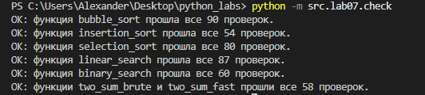
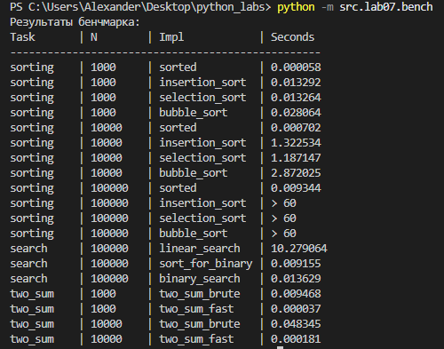

# ЛР7 — Поиск, сортировка и измерение времени

## Задание А: Поиск (search.py)

### `linear_search`

```python
def linear_search(nums, x) -> int:
    """
    Линейный поиск числа x в списке nums. Возвращаем индекс первого элемента, равного x.
    Если такой элемент отсутствует, возвращаем -1.
    """
    for i in range(len(nums)):
        if nums[i] == x:
            return i
    return -1
```


### `binary_search`

```python
def binary_search(sorted_nums, x) -> int:
    """
    Возвращаем индекса любого элемента в списке sorted_nums, равного x.
    Если такой элемент отсутствует, возвращаем -1.
    Список должен быть изначально отсортирован.
    На неотсортированном списке результат не определён.
    """
    lo = 0
    hi = len(sorted_nums) - 1
    while lo <= hi:
        mid = (hi+lo) // 2
        if sorted_nums[mid] == x: return mid
        elif sorted_nums[mid] < x: lo = mid + 1
        else: hi = mid - 1
    return -1
```


### `two_sum_brute`

```python
def two_sum_brute(nums, target) -> tuple[int, int] | None:
    """
    Ищем два индекса (i, j) таких, что nums[i] + nums[j] == target и i < j.
    Возвращаем tuple(i, j) при наличии такой пары, иначе None.
    Поиск двойным проходом по списку.
    """
    for i in range(len(nums) - 1):
        for j in range(i+1, len(nums)):
            if nums[i] + nums[j] == target:
                return (i, j)
    return None
```


### `two_sum_fast`

```python
def two_sum_fast(nums, target) -> tuple[int, int] | None:
    """
    Ищем два индекса (i, j) таких, что nums[i] + nums[j] == target и i < j.
    Возвращаем tuple(i, j) при наличии такой пары, иначе None.
    Поиск через словарь.
    """
    seen = {}
    for i in range(len(nums)):
        if nums[i] in seen:
            return (seen[nums[i]], i)
        else:
            seen[target - nums[i]] = i
    return None
```


## Задание B: Сортировка (sorting.py)

### `bubble_sort`

```python
def bubble_sort(nums) -> list[int]:
    """
    Новый список, отсортированный по возрастанию.
    Исходный список не меняется.
    Пузырьковый метод.
    """
    new = nums.copy()
    for i in range(len(new)):
        swap = False
        for j in range(len(new) - i - 1):
            if new[j] > new[j+1]:
                new[j], new[j+1] = new[j+1], new[j]
                swap = True
        if not swap:
            break
    return new
```


### `insertion_sort`

```python
def insertion_sort(nums) -> list[int]:
    """
    Новый список, отсортированный по возрастанию.
    Исходный список не меняется.
    Вставочный метод.
    """
    new = nums.copy()
    for i in range(1, len(new)):
        j = i - 1
        a = new[i]
        while j >= 0 and new[j] > a:
            new[j+1] = new[j]
            j -= 1
        new[j+1] = a
    return new
```


### `selection_sort`

```python
def selection_sort(nums) -> list[int]:
    """
    Новый список, отсортированный по возрастанию.
    Исходный список не меняется.
    Выборочный метод.
    """
    new = nums.copy()
    for i in range(len(new)):
        k1 = i
        for j in range(k1 + 1, len(new)):
            if new[j] < new[k1]:
                k1 = j
        new[i], new[k1] = new[k1], new[i]
    return new
```


## Задание С: Сравнение с эталоном (check.py)

```python
import random
from src.lab07.search import linear_search, binary_search, two_sum_brute, two_sum_fast
from src.lab07.sorting import bubble_sort, insertion_sort, selection_sort


def check_sorting(fn, trials: int = 100) -> None:
    """
    Проверяет функцию сортировки fn против эталонного sorted() на случайных списках.
    """
    for i in range(trials):
        n = random.randint(0, 50)
        nums = [random.randint(-100, 100) for i in range(n)]
        original = list(nums)
        result = fn(nums)
        assert result == sorted(nums), f"{fn.__name__} ошиблась на {nums}: {result}"
        assert nums == original, f"{fn.__name__} изменила исходный список"

def check_search(fn, trials: int = 100) -> None:
    """
    Проверяет функцию fn на поиск индекса на случайных списках.
    """
    if fn == "linear_search":
        for i in range(trials):
            n = random.randint(0, 50)
            nums = [random.randint(-100, 100) for i in range(n)]
            original = list(nums)
            result = fn(nums)
            assert result == nums.index(), f"{fn.__name__} ошиблась на {nums}: {result}"
            assert nums == original, f"{fn.__name__} изменила исходный список"

    elif fn == "binary_search":
        for i in range(trials):
            n = random.randint(0, 50)
            nums = sorted([random.randint(-100, 100) for i in range(n)])
            original = list(nums)
            result = fn(nums)
            assert result == nums.index(), f"{fn.__name__} ошиблась на {nums}: {result}"
            assert nums == original, f"{fn.__name__} изменила исходный список"


def check_two_sum(trials: int = 100):
    """
    Проверяет two_sum_brute и two_sum_fast на правильность поиска индексов (i, j); i < j, при отсутствии - None.
    """
    for i in range(trials):
        n = random.randint(0, 50)
        nums = sorted([random.randint(-100, 100) for i in range(n)])
        target = random.randint(-50, 50)
        res_brute = two_sum_brute(nums, target)
        res_fast = two_sum_fast(nums, target)
        if res_brute is None or res_fast is None:
            continue
        else:
            assert nums[res_brute[0]] + nums[res_brute[1]] == target, f"Функция two_sum_brute ошиблась на {nums}: {nums[res_brute[0]] + nums[res_brute[1]]} отличается от {target}"
            assert nums[res_fast[0]] + nums[res_fast[1]] == target, f"Функция two_sum_fast ошиблась на {nums}: {nums[res_fast[0]] + nums[res_fast[1]]} отличается от {target}"

if __name__=="__main__":
    random.seed(42)

    for fn in (bubble_sort, insertion_sort, selection_sort):
        amount_sorting = random.randint(50, 100)
        check_sorting(fn, amount_sorting)
        print(f"Функция {fn.__name__} прошла все {amount_sorting} проверок.")

    for fn in (linear_search, binary_search):
        amount_search = random.randint(50, 100)
        check_search(fn, amount_search)
        print(f"Функция {fn.__name__} прошла все {amount_search} проверок.")

    amount_two_sum = random.randint(50, 100)
    check_two_sum(amount_two_sum)
    print(f"Функции two_sum_brute и two_sum_fast прошли все {amount_two_sum} проверок.")
```




## Задание D: Бенчмарк (bench.py)

```python
import random
import timeit
from src.lab04.io_txt_csv import write_csv
from src.lab07.sorting import bubble_sort, selection_sort, insertion_sort
from src.lab07.search import linear_search, binary_search, two_sum_brute, two_sum_fast


def main():
    """
    Запускаем бенчмарки всех алгоритмов, выводим сводную таблицу в консоль и сохраняем её в CSV-файл.
    """
    random.seed(42)
    csv_rows: list[tuple[str, int, str, str]] = []

    sizes = [1000, 10_000, 100_000]
    for n in sizes:
        data = [random.randint(-1_000_000, 1_000_000) for i in range(n)]

        t = timeit.timeit(lambda: sorted(data), number=1)
        csv_rows.append(("sorting", n, "sorted", f"{t:.6f}"))

        for name, fn in [("insertion_sort", insertion_sort), ("selection_sort", selection_sort), ("bubble_sort", bubble_sort)]:
            if n <= 10_000:
                t = timeit.timeit(lambda: fn(data), number=1)
                csv_rows.append(("sorting", n, name, f"{t:.6f}"))
            else:
                csv_rows.append(("sorting", n, name, "> 60"))

    search_data_size = 100_000
    search_queries_count = 10_000
    search_list = [random.randint(-1_000_000, 1_000_000) for _ in range(search_data_size)]
    queries = [random.choice(search_list) for _ in range(search_queries_count)]

    t = timeit.timeit(lambda: [linear_search(search_list, q) for q in queries], number=1)
    csv_rows.append(("search", search_data_size, "linear_search", f"{t:.6f}"))

    t = timeit.timeit(lambda: sorted(search_list), number=1)
    csv_rows.append(("search", search_data_size, "sort_for_binary", f"{t:.6f}"))

    search_list = sorted([random.randint(-1_000_000, 1_000_000) for _ in range(search_data_size)])
    t = timeit.timeit(lambda: [binary_search(search_list, q) for q in queries], number=1)
    csv_rows.append(("search", search_data_size, "binary_search", f"{t:.6f}"))

    for n in [1_000, 10_000]:
        ts_data = [random.randint(-1_000_000, 1_000_000) for _ in range(n)]
        i, j = random.sample(range(n), 2)
        target = ts_data[i] + ts_data[j]

        t = timeit.timeit(lambda: two_sum_brute(ts_data, target), number=1)
        csv_rows.append(("two_sum", n, "two_sum_brute", f"{t:.6f}"))

        t = timeit.timeit(lambda: two_sum_fast(ts_data, target), number=1)
        csv_rows.append(("two_sum", n, "two_sum_fast", f"{t:.6f}"))

    header = ("Task", "N", "Impl", "Seconds")
    write_csv(csv_rows, "data/lab07/bench.csv", header=header)

    print("Результаты бенчмарка:")
    print(f"{'Task':<10} | {'N':<8} | {'Impl':<15} | {'Seconds':<10}")
    print("-" * 50)
    for task, n, impl, seconds in csv_rows:
        print(f"{task:<10} | {n:<8} | {impl:<15} | {seconds:<10}")


if __name__ == "__main__":
    main()
```




## Таблица бенчмарка

Взято из data/lab07/bench.csv.

```
task,n,impl,seconds
sorting,1000,sorted,0.000058
sorting,1000,insertion_sort,0.013292
sorting,1000,selection_sort,0.013264
sorting,1000,bubble_sort,0.028064
sorting,10000,sorted,0.000702
sorting,10000,insertion_sort,1.322534
sorting,10000,selection_sort,1.187147
sorting,10000,bubble_sort,2.872025
sorting,100000,sorted,0.009344
sorting,100000,insertion_sort,> 60
sorting,100000,selection_sort,> 60
sorting,100000,bubble_sort,> 60
search,100000,linear_search,10.279064
search,100000,sort_for_binary,0.009155
search,100000,binary_search,0.013629
two_sum,1000,two_sum_brute,0.009468
two_sum,1000,two_sum_fast,0.000037
two_sum,10000,two_sum_brute,0.048345
two_sum,10000,two_sum_fast,0.000181
```


